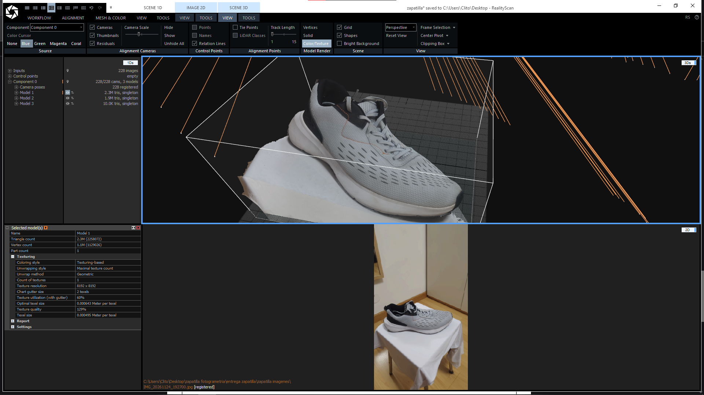

Controles:
asdw-mover
u-agarrar
f-bajar
r-subir
q-inclinación camara izquierda
e-inclinación camara derecha

Valores físicos:
masa bola-13Kg
base color-3D3AFFFF
Metalic-0,0
Roughness-0,3

masa bolos-1.5Kg

Mejoras implementadas:
Peso real de bolos
Mesa preparada para juntar todas las partes de mr potato
Implementado un sofa para romper junto a una almadena

PRACTICA FOTOGRAMETRIA
Zapatilla deportiva, 228 fotos, la escala es una zapatilla de pie 42, que es aproximadamente 26-27cm
LOD0: 2,3 Millones de triángulos, resolución 8192x8192
LOD1: 1,9 Millones de triángulos, resolución 8192x8192
LOD2: 10 mil triángulos, 2048x2048

IMÁGENES:

